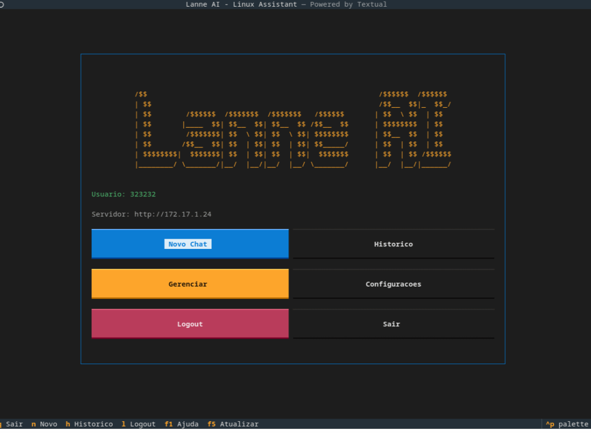
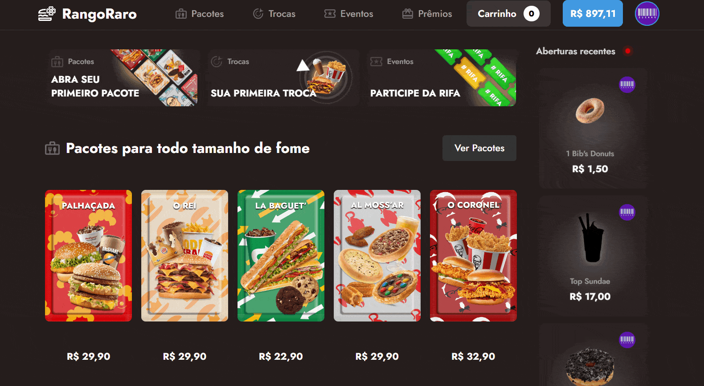

 

  

  
  
  

 

<h2>Sobre Mim</h2>

<blockquote>
  Profissional multidisciplinar atuando na intersecção entre <strong>Inteligência Artificial</strong>, <strong>Desenvolvimento Web</strong> e <strong>Design (UI/UX e 3D)</strong> — especializado em traduzir requisitos técnicos em produtos completos, unindo lógica, automação e acabamento visual.
</blockquote>

<table>
  <tr>
    <td width="50%" valign="top">
      <h4>Atuação &amp; Experiência</h4>
      <ul>
        <li><strong>AI Quality Analyst — Turing:</strong> Refinamento, avaliação lógica e fine-tuning de LLMs em português.</li>
        <li><strong>Instrutor de Robótica — Instituto Alpha Lumen:</strong> Ensino de lógica de programação, eletrônica e robótica educacional.</li>
        <li><strong>Dev &amp; Infraestrutura — SENAI:</strong> Desenvolvimento front-end (HTML/CSS) e gestão de ambientes computacionais.</li>
      </ul>
    </td>
    <td width="50%" valign="top">
      <h4>Formação &amp; Certificações</h4>
      <ul>
        <li><strong>Análise e Desenv. de Sistemas</strong> — SENAI Félix Guisard</li>
        <li><strong>Técnico em Infraestrutura de Redes</strong> — SENAI Santos Dumont</li>
        <li><strong>Cloud &amp; IA:</strong> Microsoft Azure (AI-901 &amp; AZ-900), AWS Cloud Foundations, Google Cloud (ML APIs &amp; Networking) e Inglês C1 Advanced.</li>
      </ul>
    </td>
  </tr>
</table>

 

<h2>MVPs em Destaque</h2>

  <em>Projetos desenvolvidos em parceria com <a href="https://github.com/gerlachsg">@gerlachsg</a> (Arquitetura Back-end &amp; Banco de Dados), com minha atuação liderando <strong>UI/UX Design, Front-end, Engenharia de IA e Prototipação</strong>.</em>

<table>
  <tr>
    <td width="33.3%" valign="top">
      

        <h3>Lanne.ai</h3>
        
      

       
      

        <strong>Agente de IA para administração e diagnóstico Linux multi-distro com interface de terminal (TUI).</strong>
      

      <ul>
        <li>Arquitetura de <strong>6 microsserviços (FastAPI)</strong> com API Gateway, motor RAG vetorial próprio e classificador de intenção em Machine Learning (Scikit-Learn) para execução segura de comandos.</li>
        <li>Interface TUI modular (Textual/Rich) e contratos padronizados com Pydantic v2.</li>
        <li><strong>Medalha de Ouro</strong> no TCC SENAI (2024), apresentado para +200 pessoas e banca técnica.</li>
      </ul>
      

        
        
        
        
        
          
          
        
         
        
        
      

    </td>
    <td width="33.3%" valign="top">
      

        <h3>Rango Raro</h3>
        
      

       
      

        <strong>Plataforma web de delivery gamificado com caixas gastronômicas probabilísticas e economia interna.</strong>
      

      <ul>
        <li>Mecânica de <em>loot boxes</em> com probabilidades reais, conversão instantânea de pratos em saldo digital, sistema de XP, rifas e vitrine de prêmios.</li>
        <li>Design autoral no Figma, animações 3D em CSS, operação de entregas/avaliações, painel Admin e persistência no Firebase (Auth &amp; Firestore).</li>
      </ul>
      

        
        
        
        
          
        
        
         
        
      

    </td>
    <td width="33.3%" valign="top">
      

        <h3>GesPão (IHM &amp; IoT)</h3>
        
      

       
      

        <strong>Ecossistema industrial mobile, IoT e Copiloto IA para controle de estoque e produção em panificadoras.</strong>
      

      <ul>
        <li>App <strong>React Native (Expo)</strong> <em>offline-first</em> (fila de sincronização e cache) com scanner de código de barras/QR, algoritmo <strong>FEFO</strong> e gestão de fornadas/perdas.</li>
        <li>Agente IA no <strong>n8n + Groq</strong> com <em>Tool Calling</em> sob demanda no Firestore e telemetria de câmara fria via <strong>ESP32</strong> + servidor Python.</li>
      </ul>
      

        
        
        
        
        
        
        
        
        
          
        
        
      

    </td>
  </tr>
</table>

 

<h2>Stack &amp; Ecossistema Técnico</h2>

  

    
  

  

    
  

  

    
  

  

    
  

 

<table>
  <thead>
    <tr>
      <th align="left">Domínio</th>
      <th align="left">Tecnologias e Ferramentas</th>
    </tr>
  </thead>
  <tbody>
    <tr>
      <td><strong>IA &amp; Automação</strong></td>
      <td>Engenharia de Prompts, Análise de Qualidade de IA (LLMs), Agentes Autônomos (ReAct &amp; Tool Calling), RAG, Workflows no n8n</td>
    </tr>
    <tr>
      <td><strong>Desenvolvimento &amp; AI Dev</strong></td>
      <td>Python (FastAPI), HTML5, CSS3, Java (Base), Git &amp; GitHub,Claude Code, Antigravity</td>
    </tr>
    <tr>
      <td><strong>Cloud, IoT &amp; Infraestrutura</strong></td>
      <td>Firebase (Firestore &amp; Auth), AWS (Cloud Foundations), Microsoft Azure (AI-901 &amp; AZ-900), Google Cloud Platform, Linux (Multi-distro), ESP32</td>
    </tr>
    <tr>
      <td><strong>Design, UI/UX &amp; 3D</strong></td>
      <td>Figma (UI/UX &amp; Prototipação), Canva, Blender, Autodesk Maya, ZBrush, Substance 3D Painter, Photoshop, Unreal Engine</td>
    </tr>
  </tbody>
</table>

 

<h2>Reconhecimentos &amp; Premiações</h2>

<table>
  <tr>
    <td width="50%" valign="top">
      <strong>Medalha de Ouro — TCC SENAI "Santos Dumont" (2024)</strong>
       
      Criação e pitch da <em>Lanne.ai</em> (IA especialista em Linux) para banca técnica e plateia de +200 pessoas.
    </td>
    <td width="50%" valign="top">
      <strong>Excelência — Grand Prix SENAI de Inovação (2023)</strong>
       
      Desenvolvimento do protótipo <em>Aprende AI</em>, plataforma educacional adaptativa com geração automatizada de nivelamento.
    </td>
  </tr>
</table>

 

